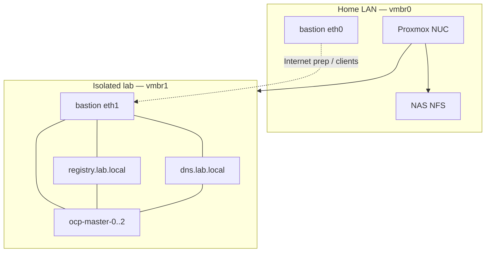

# Lab architecture

Design reference for **Day 0**. Procedures: [../deploy/DAY0.md](../deploy/DAY0.md) → [DAY1](../deploy/DAY1.md) → [DAY2](../deploy/DAY2.md).

## Why Proxmox for now

This lab runs on **Proxmox VE** for now, **while waiting to resolve RHEL / NAS NFS issues** that blocked a cleaner RHEL-centric layout (NFS was too slow / unstable for OpenShift etcd).

Proxmox is therefore the practical host: VMs on mixed storage (`nfs_vm` for dns, bastion, and the registry; **`local-lvm`** on the NUC SSD for OCP). Revisit a RHEL-only hosting model once NFS performance (or an alternative shared storage) is fixed — see [Storage](#storage) below.

## Overview

## Official stages → lab

| Red Hat Day | Lab |
|-------------|-----|
| Day 0 Design | Topology, sizing, Proxmox/templates/secrets — [../deploy/DAY0.md](../deploy/DAY0.md) |
| Day 1 Deployment | VMs, mirror, agent install → Ready — [../deploy/DAY1.md](../deploy/DAY1.md) |
| Day 2 Operations | Catalog, OSUS, LVMS, Virt — [../deploy/DAY2.md](../deploy/DAY2.md) |

## VM sizing (NUC 64 GiB)

| VM | vCPU | RAM | Disk |
|----|------|-----|------|
| bastion | 2 | 8 GiB | 40 GiB NFS |
| dns | 1 | 1–2 GiB | ~10 GiB NFS |
| registry | 2 | 4–8 GiB | OS 32 GiB + data 120 GiB on `nfs_vm` |
| ocp-master-0..2 (compact3) | 8 | 16 GiB each | 120G OS + 100G LVMS |

SNO alternative: one node ~8 cores / 24 GiB — [../../terraform/lab-ocp/README.md](../../terraform/lab-ocp/README.md)

## Storage

| Datastore | Used for | Why |
|-----------|----------|-----|
| **`nfs_vm`** (NAS) | dns, bastion, **registry** (OS + data) + template `rhel10-nfs` | Frees the NUC SSD for OCP |
| **`nfs_iso`** (NAS) | RHEL DVD, agent ISO | Shared ISO library |
| **`local-lvm`** (NUC SSD) | **OCP** disks + template `rhel10-tpl` | etcd / control plane — see below |

Details: [../../terraform/README.md](../../terraform/README.md) · templates: [../../proxmox/rhel-cloudinit-template.md](../../proxmox/rhel-cloudinit-template.md)

### Why OCP stays on the NUC SSD

Same NFS limitation that keeps the lab on **Proxmox + local-lvm** for OpenShift disks (see [Why Proxmox for now](#why-proxmox)).

The mirror registry (OS + 120 GiB data) is on **`nfs_vm`** so the NUC SSD can hold the compact3 disks. OpenShift node disks stay on **`local-lvm`** (`storage_perf` in `lab-ocp`): NFS latency and IOPS are too weak for **etcd** and control-plane disks (timeouts, slow API, unstable Ready).

`oc-mirror` and cluster pulls against the registry are slower on NFS. dns, bastion, and registry clone **`rhel10-nfs`** so EFI and OS stay on `nfs_vm`.

## Related

- [network.md](network.md) · [bastion.md](bastion.md) · [versions.md](versions.md) · [../faq/README.md](../faq/README.md)
